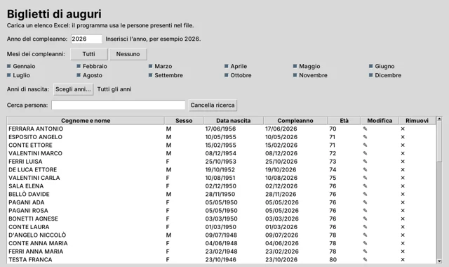
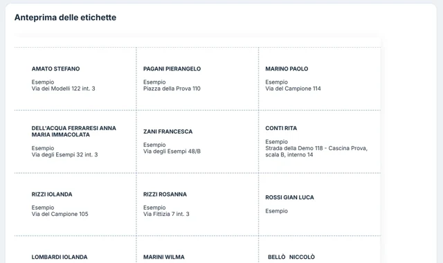
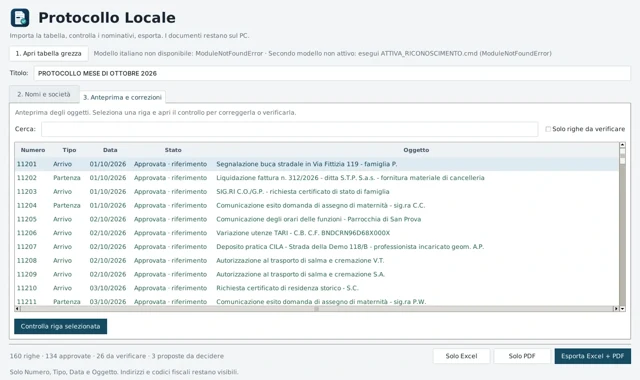
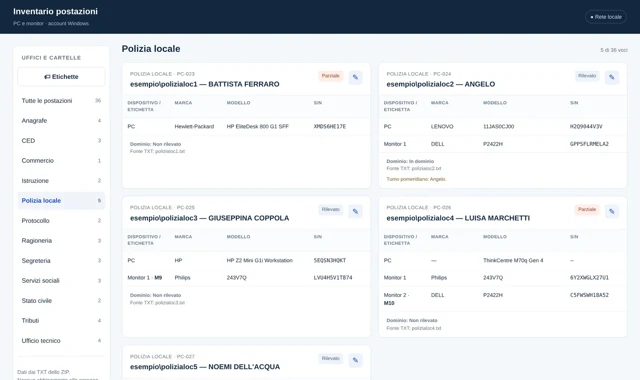
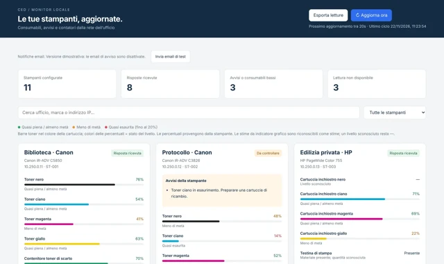
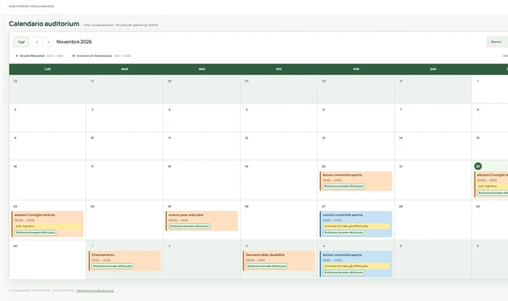
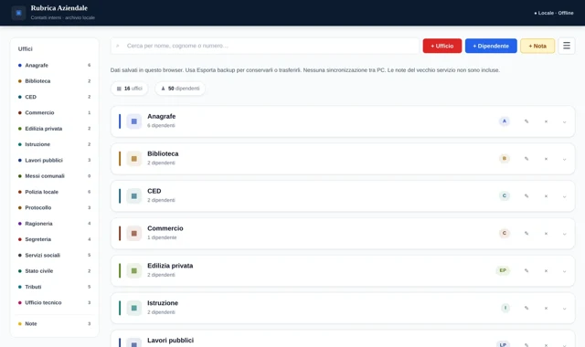

# Progetti di stage · Angelo Erik Scontrino

Sette strumenti realizzati durante lo stage del 4° anno al Comune di Verolanuova: piccoli programmi che tolgono lavoro ripetitivo agli uffici, funzionano in locale e lasciano i dati sul computer.

> **Versione pubblica ripulita.** Codice, dati di prova, schermate e descrizioni sono stati controllati e ripuliti da dati sensibili: nomi, indirizzi, account, matricole, recapiti e credenziali sono inventati, e non ci sono riferimenti interni reali. Lo stemma dell'ente non è incluso: Protocollo Locale ha un'icona nuova, disegnata per questa versione.

| N. | Progetto | Categoria | Tecnologie | Demo |
|---|---|---|---|---|
| 01 | [Biglietti di auguri](https://github.com/Shad272/biglietti-auguri) | Automazione documentale | Python, Tkinter, Excel, PDF | Sì |
| 02 | [Etichette](https://github.com/Shad272/etichette-locali) | Automazione documentale | HTML, JavaScript, Excel, CSV | Sì |
| 03 | [Protocollo Locale](https://github.com/Shad272/protocollo-locale) | Digitalizzazione | Python, Tkinter, Excel, PDF | Sì |
| 04 | [Inventario PC e monitor](https://github.com/Shad272/inventario-pc-monitor) | Inventario IT | Python, HTML, JavaScript | Sì |
| 05 | [Dashboard stampanti](https://github.com/Shad272/dashboard-stampanti) | Inventario IT | Python, HTML, JavaScript, SNMP, PowerShell | Sì |
| 06 | [Calendario Auditorium](https://github.com/Shad272/calendario-auditorium) | Organizzazione | Non indicate | [Online](https://calendarioauditorium-github-io.pages.dev/) |
| 07 | [Rubrica uffici e dipendenti](https://github.com/Shad272/rubrica-uffici) | Organizzazione | HTML, JavaScript | Sì |

## I progetti

### 01 · Biglietti di auguri
Dall'elenco Excel dei residenti a un PDF con un biglietto di auguri per ogni compleanno, pronto da stampare e piegare, più le etichette per le buste.

### 02 · Etichette
Da qualsiasi tabella a fogli di etichette A4 allineati al millimetro, direttamente nel browser e senza Internet.

### 03 · Protocollo Locale
Prepara il registro di protocollo da condividere: propone le iniziali al posto dei nomi, riga per riga, e lascia ogni decisione a una persona.

### 04 · Inventario PC e monitor
Riunisce le rilevazioni di PC e monitor in una vista per ufficio, con matricole, etichette, ricerca e modifica.

### 05 · Dashboard stampanti
Legge dalle stampanti di rete toner, tamburi, carta, contatori e avvisi via SNMP, e li mostra in una pagina sola.

### 06 · Calendario Auditorium
Un calendario per consultare l'utilizzo dell'auditorium condiviso fra il Comune e la scuola. Il codice non è pubblicato: il repository contiene la scheda e una schermata.

### 07 · Rubrica uffici e dipendenti
Interni e contatti degli uffici in una pagina sola, con ricerca, note, stampa e backup, anche senza rete.

## Note

- Tutti i dati nelle demo e nelle schermate sono inventati, tranne la schermata del Calendario Auditorium, presa dall'applicazione pubblicata in sola visualizzazione.
- Ogni repository ha una scheda completa (contesto, problema, soluzione, limiti) e, dove disponibile, la demo da scaricare nella cartella `demo/`.
